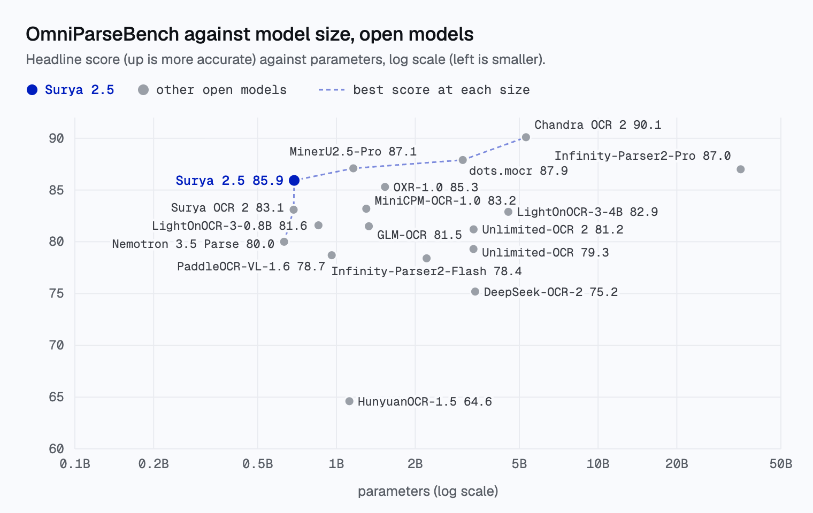
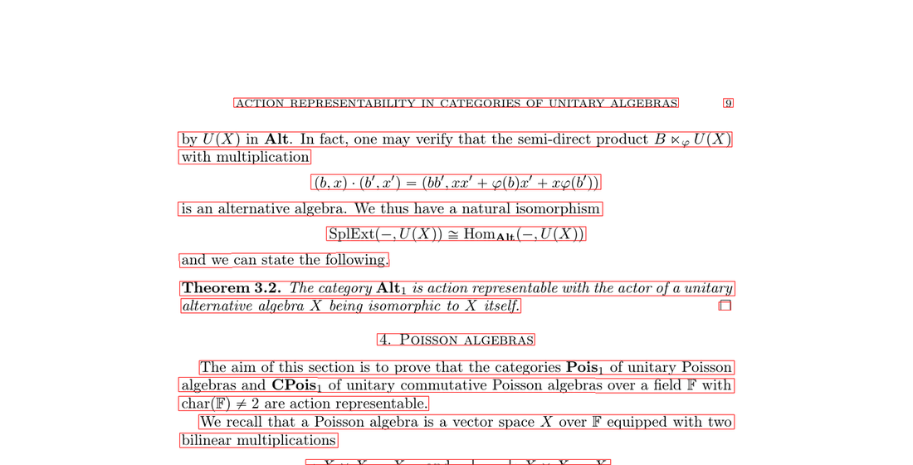
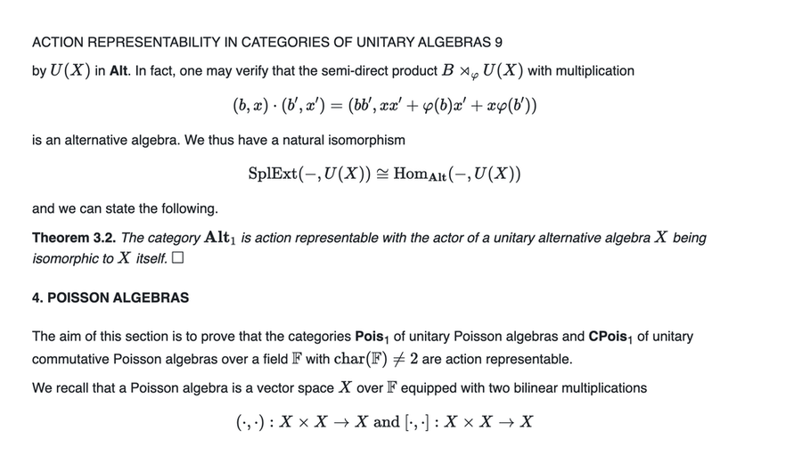
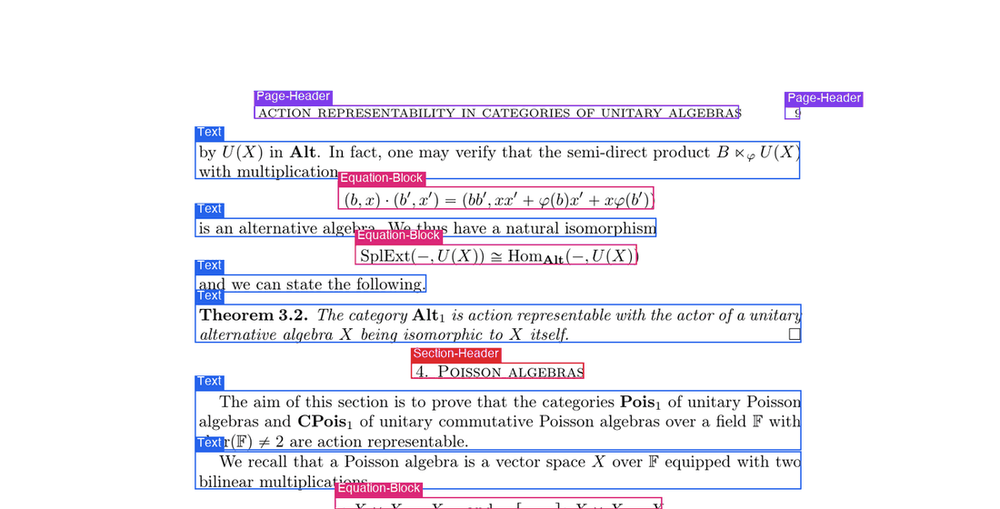

<p align="center">
  
</p>
<h1 align="center">Datalab</h1>
<p align="center">
  <strong>State of the Art models for Document Intelligence</strong>
</p>
<p align="center">
  <a href="https://www.apache.org/licenses/LICENSE-2.0"></a>
  <a href="https://www.datalab.to/pricing"></a>
  <a href="https://discord.gg/KuZwXNGnfH"></a>
</p>
<p align="center">
  <a href="https://www.datalab.to"></a>
  <a href="https://documentation.datalab.to"></a>
  <a href="https://www.datalab.to/playground"></a>
</p>

<hr/>

# Surya

Surya is a 689M param OCR model with these features:

- Accuracy - scores 85.9 on [OmniParseBench](https://huggingface.co/datasets/datalab-to/omni_parse_bench), the highest of the open models under 1B parameters we have scored, and 83.7% on [olmOCR-bench](https://huggingface.co/datasets/allenai/olmOCR-bench)
- Speed - throughput of 4.5 pages/s on one H100 at 192 DPI, 1.7x Surya 2 with MTP (see [Throughput](#throughput))
- Multilingual - scores 74.9% on an internal benchmark set of 91 languages (more [here](#multilingual))
- Layout analysis (table, image, header, etc.) with reading order
- Tables as HTML, with merged cells as colspan / rowspan (row and column geometry needs a Surya 2 checkpoint; see Limitations)

We also ship smaller models for line-level text detection and ocr error detection.  It works on a range of documents (see [usage](#usage) and [benchmarks](#benchmarks)).

## Try Datalab's Managed Platform

Our managed platform uses Surya, our highest accuracy model [Chandra](https://github.com/datalab-to/chandra), and other models.

The Datalab API turns documents into verifiable knowledge your agents act on. Every result traces back to its page and position, and one API can parse, extract, fill and edit documents.

Get started with **about 5,000 free convert pages every month** (work email) — [sign up](https://www.datalab.to/?utm_source=gh-surya) (takes under 30 seconds) or try our free [public playground](https://www.datalab.to/playground?utm_source=gh-surya).

## Model Information




|                            Detection                             |                                   OCR                                   |
|:----------------------------------------------------------------:|:-----------------------------------------------------------------------:|
|    |   |

|                               Layout                               |
|:------------------------------------------------------------------:|
|  |


Surya is named for the [Hindu sun god](https://en.wikipedia.org/wiki/Surya), who has universal vision.

## Examples

Each row links to four annotated views of the same page: text-line detection, OCR, layout and reading order (Surya 2.5).

| Name              |              Detection              |                                       OCR |                                       Layout |                                          Order |
|-------------------|:-----------------------------------:|------------------------------------------:|---------------------------------------------:|------------------------------------------------:|
| Newspaper | [Image](static/images/newspaper.png) | [Image](static/images/newspaper_text.png) | [Image](static/images/newspaper_layout.png) | [Image](static/images/newspaper_reading.png) |
| Reference book | [Image](static/images/reference.png) | [Image](static/images/reference_text.png) | [Image](static/images/reference_layout.png) | [Image](static/images/reference_reading.png) |
| Math paper | [Image](static/images/math.png) | [Image](static/images/math_text.png) | [Image](static/images/math_layout.png) | [Image](static/images/math_reading.png) |
| Government form | [Image](static/images/form.png) | [Image](static/images/form_text.png) | [Image](static/images/form_layout.png) | [Image](static/images/form_reading.png) |
| Handwritten letter | [Image](static/images/handwritten.png) | [Image](static/images/handwritten_text.png) | [Image](static/images/handwritten_layout.png) | [Image](static/images/handwritten_reading.png) |
| Corporate doc | [Image](static/images/corporate.png) | [Image](static/images/corporate_text.png) | [Image](static/images/corporate_layout.png) | [Image](static/images/corporate_reading.png) |
| Japanese tax form | [Image](static/images/japanese.png) | [Image](static/images/japanese_text.png) | [Image](static/images/japanese_layout.png) | [Image](static/images/japanese_reading.png) |

The example pages are public pages from [OmniParseBench](https://huggingface.co/datasets/datalab-to/omni_parse_bench). The newspaper (The Alpha, 1881), reference book and math paper are from [olmOCR-bench](https://huggingface.co/datasets/allenai/olmOCR-bench) (Ai2, ODC-BY 1.0). The government form is a US federal form (public domain). The handwritten letter is from the Library of Congress, Manuscript Division, Carrie Chapman Catt Papers (public domain). The corporate page is from [ParseBench](https://huggingface.co/datasets/llamaindex/ParseBench) (Apache 2.0). The Japanese form is made from a form of the National Tax Agency, Japan, under the Public Data License 1.0: 「国税庁の様式」（国税庁）（https://www.nta.go.jp/）を加工して作成. The OCR column renders Surya 2.5's HTML output; layout and reading order are drawn from its blocks, and the detection image is from the text-line detector.

# Commercial usage

The Surya code is licensed under Apache 2.0. The model weights use a modified AI Pubs Open Rail-M license (free for research, personal use, and startups under $5M funding/revenue). For broader commercial licensing of the model weights, visit our pricing page [here](https://www.datalab.to/pricing?utm_source=gh-surya).

# Installation

Install with:

```shell
pip install surya-ocr
```

## Inference backend prerequisites

Surya auto-spawns the server on first use, and you need `vllm` (NVIDIA GPU) or `llama.cpp` (CPU / Apple Silicon):

- **NVIDIA GPU:** [Docker](https://docs.docker.com/get-docker/) plus the [NVIDIA Container Toolkit](https://docs.nvidia.com/datacenter/cloud-native/container-toolkit/latest/install-guide.html).
- **CPU / Apple Silicon:** the `llama-server` binary from llama.cpp:
  ```shell
  brew install llama.cpp     # macOS
  # or grab a release from https://github.com/ggml-org/llama.cpp/releases
  ```

## Upgrading from Surya v1

If you have v1 code, you can migrate to this:

```python
# v2
from surya.inference import SuryaInferenceManager
from surya.recognition import RecognitionPredictor

manager = SuryaInferenceManager()              # auto-spawns vllm or llama-server
rec = RecognitionPredictor(manager)
predictions = rec([image])
```

What's different:
- `SuryaInferenceManager` replaces `FoundationPredictor`. Same manager instance is shared across `LayoutPredictor`, `RecognitionPredictor`, `TableRecPredictor`.
- Output schemas changed: see the per-section JSON tables below. Highlights — `text_lines` → `blocks` (with `html`); layout dropped `top_k`, added `count`; table_rec dropped `is_header` / `colspan` / `rowspan` from cells.

# Usage

Surya 2.5 runs layout, OCR, and table recognition through a single VLM.  The inference manager will spawn one for you on first use; you can also point it at an existing server via `SURYA_INFERENCE_URL=http://host:port/v1`.

- Inspect the settings in `surya/settings.py`.  You can override any setting via env var (e.g. `SURYA_INFERENCE_BACKEND=vllm`).
- Text detection and OCR errors are separate models.

### Server lifecycle (`--keep_server`)

By default each command spawns the VLM server on startup and shuts it down on
exit — so running several commands in a row pays the startup (and, on GPU, the
model-load) cost every time. Pass `--keep_server` to leave the server running
so later commands attach to it instead of re-spawning:

```shell
surya_ocr    DATA_PATH --keep_server   # spawns the server and leaves it up
surya_layout DATA_PATH                 # attaches to the running server
surya_table  DATA_PATH                 # ...and so on, no re-spawn
```

`--keep_server` works on every command. Stop the server when you're done
(`docker stop` the `surya-vllm-*` container, or kill the `llama-server`
process), or set `SURYA_INFERENCE_KEEP_ALIVE=1` to make keep-alive the default.

## Interactive App

I've included a streamlit app that lets you interactively try Surya on images or PDF files.  Run it with:

```shell
pip install streamlit pdftext
surya_gui
```

## OCR (text recognition)

This command will write out a json file with the detected text and bboxes:

```shell
surya_ocr DATA_PATH
```

- `DATA_PATH` can be an image, pdf, or folder of images/pdfs
- `--images` will save images of the pages and detected blocks (optional)
- `--output_dir` specifies the directory to save results to instead of the default
- `--page_range` specifies the page range to process in the PDF, specified as a single number, a comma separated list, a range, or comma separated ranges - example: `0,5-10,20`.
- `--keep_server` leaves the inference server running after the command exits so later commands reuse it (see [Server lifecycle](#server-lifecycle---keep_server)).  Available on every command.

The `results.json` file contains a dict keyed by input filename (no extension). Each value is a list of page dicts. Each page dict contains:

- `blocks` - per-block OCR results in reading order
  - `label` - canonicalized layout label (e.g. `Text`, `SectionHeader`, `Table`, `Equation`, `Picture`, `Form`, `PageHeader`, ...). See `surya/layout/label.py:LAYOUT_PRED_RELABEL` for the full canonical-name set.
  - `raw_label` - original label emitted by the model, before canonicalization
  - `reading_order` - 0-indexed position in layout output
  - `html` - block content as HTML (math wrapped in `<math>...</math>`, tables as `<table>...</table>`, etc.). `""` if the block was skipped
  - `polygon` - 4-corner polygon in `[[x0,y0],[x1,y0],[x1,y1],[x0,y1]]` order
  - `bbox` - axis-aligned `[x0, y0, x1, y1]` derived from the polygon
  - `confidence` - mean per-token probability across the block's decode (0-1)
  - `skipped` - true if the block was a visual label (e.g. Picture) and not OCR'd
  - `error` - true if the block OCR call failed
- `image_bbox` - `[0, 0, width, height]` for the page image

**Performance tips**

- Throughput is governed by the inference backend.  With `vllm`, raise `--max-num-seqs` / `--max-num-batched-tokens` (or `SURYA_INFERENCE_PARALLEL` on the client side) to keep more pages in flight. With `llama.cpp`, set `SURYA_INFERENCE_PARALLEL` to match `--parallel` on `llama-server`.
- DPI can also impact throughput significantly - you can adjust the DPI settings to make the right throughput/accuracy tradeoff for your usecase.  Try going from 192 to 96 for improved throughput.
- MTP can also impact latency/throughput. It is turned on automatically only when the checkpoint config declares an MTP head; set `VLLM_ENABLE_MTP=true|false` to override, and `VLLM_MTP_TOKENS` to change the draft length.

### From python

```python
from PIL import Image
from surya.inference import SuryaInferenceManager
from surya.recognition import RecognitionPredictor

manager = SuryaInferenceManager()
recognition_predictor = RecognitionPredictor(manager)

# Default: full-page OCR. One VLM call per page. Returns one PageOCRResult per
# image: `.blocks` (each with label, html, polygon, bbox, confidence, ...) and
# `.image_bbox` — the same schema as block mode.
predictions = recognition_predictor([Image.open(IMAGE_PATH)])

# Block mode: pre-run layout, then per-block OCR. Same return schema as above.
# Auto-selected when `layout_results` is passed.
from surya.layout import LayoutPredictor
layout = LayoutPredictor(manager)
layouts = layout([Image.open(IMAGE_PATH)])
predictions = recognition_predictor([Image.open(IMAGE_PATH)], layouts)
```


## Text line detection

This command will write out a json file with the detected bboxes.

```shell
surya_detect DATA_PATH
```

- `DATA_PATH` can be an image, pdf, or folder of images/pdfs
- `--images` will save images of the pages and detected text lines (optional)
- `--output_dir` specifies the directory to save results to instead of the default
- `--page_range` specifies the page range to process in the PDF, specified as a single number, a comma separated list, a range, or comma separated ranges - example: `0,5-10,20`.

The `results.json` file will contain a json dictionary where the keys are the input filenames without extensions.  Each value will be a list of dictionaries, one per page of the input document.  Each page dictionary contains:

- `bboxes` - detected bounding boxes for text
  - `bbox` - the axis-aligned rectangle for the text line in (x1, y1, x2, y2) format.  (x1, y1) is the top left corner, and (x2, y2) is the bottom right corner.
  - `polygon` - the polygon for the text line in (x1, y1), (x2, y2), (x3, y3), (x4, y4) format.  The points are in clockwise order from the top left.
  - `confidence` - the confidence of the model in the detected text (0-1)
- `vertical_lines` - vertical lines detected in the document
  - `bbox` - the axis-aligned line coordinates.
- `page` - the page number in the file
- `image_bbox` - the bbox for the image in (x1, y1, x2, y2) format.  (x1, y1) is the top left corner, and (x2, y2) is the bottom right corner.  All line bboxes will be contained within this bbox.

**Performance tips**

Detection is a torch model. `DETECTOR_BATCH_SIZE` defaults to an auto-picked value at runtime; override the env var to control VRAM usage on GPU and raise it on larger cards.

### From python

```python
from PIL import Image
from surya.detection import DetectionPredictor

det_predictor = DetectionPredictor()
predictions = det_predictor([Image.open(IMAGE_PATH)])
```

## Layout and reading order

This command will write out a json file with the detected layout and reading order.

```shell
surya_layout DATA_PATH
```

- `DATA_PATH` can be an image, pdf, or folder of images/pdfs
- `--images` will save images of the pages and detected text lines (optional)
- `--output_dir` specifies the directory to save results to instead of the default
- `--page_range` specifies the page range to process in the PDF, specified as a single number, a comma separated list, a range, or comma separated ranges - example: `0,5-10,20`.

The `results.json` file contains a dict keyed by input filename (no extension). Each value is a list of page dicts. Each page dict contains:

- `bboxes` - layout boxes in reading order
  - `polygon` - 4-corner polygon `[[x0,y0],[x1,y0],[x1,y1],[x0,y1]]`
  - `bbox` - axis-aligned `[x0, y0, x1, y1]` derived from the polygon
  - `label` - canonicalized label. One of `Caption`, `Footnote`, `Equation`, `ListGroup`, `PageHeader`, `PageFooter`, `Picture`, `SectionHeader`, `Table`, `Text`, `Figure`, `Code`, `Form`, `TableOfContents`, `ChemicalBlock`, `Diagram`, `Bibliography`, `BlankPage`
  - `raw_label` - original label emitted by the model
  - `position` - 0-indexed reading order
  - `count` - model's token estimate for OCR'ing this block (rounded to multiples of 50; used to size the per-block decode budget)
  - `confidence` - mean per-token probability across the layout decode (0-1)
- `image_bbox` - `[0, 0, width, height]`
- `raw` - raw JSON the layout model emitted, for debugging
- `error` - true if the layout call failed

**Performance tips**

Layout runs through the shared inference backend. Throughput tuning is the same as OCR — see Performance tips above.

### From python

```python
from PIL import Image
from surya.inference import SuryaInferenceManager
from surya.layout import LayoutPredictor

layout_predictor = LayoutPredictor(SuryaInferenceManager())
layout_predictions = layout_predictor([Image.open(IMAGE_PATH)])
```

## Table Recognition

This command will write out a json file with each detected table as HTML (with `colspan` / `rowspan` for merged cells).  With a Surya 2 checkpoint you can also ask for row/column bounding boxes and cell ids (`--mode simple`).  If you want to get cell positions and text, along with nice formatting, check out the [marker](https://github.com/datalab-to/marker) repo.  You can use the `TableConverter` to detect and extract tables in images and PDFs.  It supports output in json (with bboxes), markdown, and html.

```shell
surya_table DATA_PATH
```

- `DATA_PATH` can be an image, pdf, or folder of images/pdfs
- `--images` will save annotated row + column overlays alongside the json (optional; `--mode simple` only)
- `--output_dir` specifies the directory to save results to instead of the default
- `--page_range` specifies the page range to process in the PDF, specified as a single number, a comma separated list, a range, or comma separated ranges - example: `0,5-10,20`.
- `--mode` is `full` (default: table HTML) or `simple` (row and column boxes with cells derived from their intersections; Surya 2 checkpoints only, Surya 2.5 returns an error for it)
- `--skip_table_detection` tells table recognition not to detect tables first.  Use this if your image is already cropped to a table.

The `results.json` file contains a dict keyed by input filename (no extension). Each value is a list of per-table dicts. Each table dict contains:

- `rows` - detected table rows in reading order (`simple` mode only)
  - `polygon` / `bbox` - row geometry (same convention as everywhere else)
  - `row_id` - 0-indexed row id
- `cols` - detected table columns
  - `polygon` / `bbox` - column geometry
  - `col_id` - 0-indexed column id
- `cells` - geometric row × column intersections (simple mode)
  - `polygon` / `bbox` - cell geometry
  - `row_id`, `col_id`, `cell_id`
- `html` - full `<table>...</table>` HTML (populated in `full` mode, the CLI default; handles spanning cells / header rows). `null` in simple mode.
- `mode` - `"simple"` or `"full"`
- `image_bbox` - the table crop bbox
- `error` - true if the table_rec call failed
- `raw` - raw model output, for debugging

**Performance tips**

Table recognition routes through the shared VLM. Throughput tuning is the same as OCR.

### From python

```python
from PIL import Image
from surya.inference import SuryaInferenceManager
from surya.table_rec import TableRecPredictor

table_rec_predictor = TableRecPredictor(SuryaInferenceManager())

# Table HTML, with colspan / rowspan for merged cells (what `surya_table` does by default):
table_predictions = table_rec_predictor.predict_full([Image.open(IMAGE_PATH)])

# Rows + columns only, cells derived from intersections (Surya 2 checkpoints only):
# table_predictions = table_rec_predictor([image])
```

## Math / equations

Surya 2.5 handles math inline as part of full-page OCR — recognized equations
come back inside `<math>...</math>` tags in the same HTML output as
surrounding prose, in KaTeX-compatible LaTeX. No separate LaTeX OCR pass.

## Output format

The model writes each block as a header of special tokens, a label and four coordinates (x0, y0, x1, y1, normalized to 0-1000), followed by the block content: `<|Text|><|120|><|87|><|881|><|255|><p>...</p>`. Tables omit closing tags and mark merged cells with `data-cs` / `data-rs` and `data-kind="parent"` / `"ghost"` spans, which makes pages shorter to write. The `surya-ocr` package decodes all of this for you. If you serve the model yourself, run its output through `surya.inference.parsers.clean_block_html` / `parse_full_page_html`; the lower-level `compact.decode` alone does not convert parent/ghost spans. Your server must return special tokens (llama-server: `--special`).

# Inference Backends

Layout / OCR / table_rec all share one VLM, served either by `vllm` (GPU) or `llama.cpp` (CPU / Apple Silicon). The `SuryaInferenceManager` will spawn one automatically; you can also point at a pre-running server:

```bash
# Attach to an existing vllm
export SURYA_INFERENCE_BACKEND=vllm
export SURYA_INFERENCE_URL=http://localhost:8000/v1
```

| Setting                           | Default                           | Notes                                                  |
|-----------------------------------|-----------------------------------|--------------------------------------------------------|
| `SURYA_INFERENCE_BACKEND`         | auto (vllm if NVIDIA, else llamacpp) | `vllm` \| `llamacpp` \| `mlx` \| unset (auto)         |
| `SURYA_INFERENCE_URL`             | (auto-spawn)                      | Attach to a running OpenAI-compatible server          |
| `SURYA_INFERENCE_PARALLEL`        | 8                                 | Client-side concurrency to the backend                |
| `SURYA_INFERENCE_KEEP_ALIVE`      | false                             | Leave the spawned server up after exit (cf. `--keep_server`) |
| `SURYA_GUIDED_LAYOUT`             | true                              | JSON-schema-constrained layout decode                 |
| `VLLM_MAX_MODEL_LEN`              | 24576                             | Must hold the largest image (~8k tokens) + prompt + `SURYA_MAX_TOKENS_FULL_PAGE` (12288) |
| `VLLM_ENABLE_MTP`                 | auto                              | Auto = on only if the checkpoint config declares an MTP head |
| `SURYA_MLX_MODEL`                 | (none)                            | MLX checkpoint (local dir or HF repo) for `SURYA_INFERENCE_BACKEND=mlx` |
| `SURYA_STOP_STRINGS`              | (none)                            | Comma-separated stop strings sent with every request (e.g. `<\|im_end\|>` for checkpoints whose end marker is spelled as text) |
| `SURYA_STOP_TOKEN_IDS`            | (none)                            | Comma-separated stop token ids (vllm only; ignored by llama.cpp) |
| `LLAMA_CPP_SPECIAL`               | true                              | Pass `--special` to llama-server so block labels and coordinates (special tokens in Surya 2.5 output) are returned in the text |

Install `surya-ocr` and `vllm` in separate environments (the default backend runs vllm in Docker for this reason): `surya-ocr` pins `opencv-python-headless==4.11.0.86`, while vllm 0.25 requires `>=4.13`, so `pip check` reports a conflict if both share one environment.

## MLX backend (Apple Silicon)

```bash
pip install mlx-vlm==0.7.10   # tested version; experimental backend
export SURYA_INFERENCE_BACKEND=mlx
export SURYA_MLX_MODEL=/path/to/surya-mlx-int8     # or an HF repo with MLX weights
surya_ocr page.png
```

The manager spawns `mlx_vlm.server` for that checkpoint (or attaches to one at `SURYA_INFERENCE_URL`) and uses the same OpenAI-compatible client as the other backends. Auto-detection still picks vllm / llama.cpp; MLX is opt-in. `mlx_vlm.server` ignores the `stop` request field, so generation only stops when the model emits its end token: use a checkpoint that does, and do not rely on `SURYA_STOP_STRINGS` with this backend.

## Building GGUF and MLX models for a checkpoint

```bash
# llama.cpp (Metal / CPU / CUDA): writes <name>.gguf and <name>-mmproj.gguf
python -m surya.scripts.build_gguf --checkpoint <repo-or-dir> --out-dir ./gguf-build --name <name> --outtype bf16

# MLX (Apple Silicon), optionally quantized (needs `pip install mlx-vlm==0.7.10`)
python surya/scripts/build_mlx.py --checkpoint <repo-or-dir> --out-dir ./mlx-build --q-bits 8
```

Both scripts repair things the stock converters get wrong for the character-level vocabulary: the GGUF script registers the checkpoint's pre-tokenizer hash and, when the Hugging Face tokenizer spells `<|im_end|>` in prompts (Surya 2.5), renames the token's text so llama.cpp tokenizes the prompt the same way; the MLX script restores the original tokenizer files and the end-token id after conversion.

# Limitations

- This is specialized for document OCR. Performance on photos or natural scenes is not the goal.
- Layout / OCR / table_rec all need a running inference backend (vllm or llama.cpp). Detection runs purely on torch and works without it.
- For hard documents (handwriting, complex tables, math) or large volumes, the hosted [Datalab API](https://www.datalab.to/?utm_source=gh-surya) uses Chandra and other models, with no infrastructure to manage.
- Surya 2.5 reads tables as HTML (full-page OCR, block mode, `surya_table`), but not row and column geometry: `surya_table --mode simple` returns an error. Use a Surya 2 checkpoint (`SURYA_MODEL_CHECKPOINT=datalab-to/surya-ocr-2`) for geometry.

## Troubleshooting

If OCR isn't working properly:

- Try increasing resolution of the image so the text is bigger.  If the resolution is already very high, try decreasing it to no more than a `2048px` width.
- Preprocessing the image (binarizing, deskewing, etc) can help with very old/blurry images.
- You can adjust `DETECTOR_BLANK_THRESHOLD` and `DETECTOR_TEXT_THRESHOLD` if you don't get good results.  `DETECTOR_BLANK_THRESHOLD` controls the space between lines - any prediction below this number will be considered blank space.  `DETECTOR_TEXT_THRESHOLD` controls how text is joined - any number above this is considered text.  `DETECTOR_TEXT_THRESHOLD` should always be higher than `DETECTOR_BLANK_THRESHOLD`, and both should be in the 0-1 range.  Looking at the heatmap from the debug output of the detector can tell you how to adjust these (if you see faint things that look like boxes, lower the thresholds, and if you see bboxes being joined together, raise the thresholds).

# Manual install

If you want to develop surya, you can install it manually with [uv](https://docs.astral.sh/uv/):

```bash
git clone https://github.com/datalab-to/surya.git
cd surya
uv sync --group dev      # installs runtime + dev deps
uv run surya_ocr ...     # or `source .venv/bin/activate` to enter the venv
```

# Benchmarks

Surya 2.5 is a single VLM that handles layout analysis, OCR (full-page or
per-block), and table reading in one model. We evaluate end-to-end on two
benchmarks: [OmniParseBench](https://huggingface.co/datasets/datalab-to/omni_parse_bench),
our open parsing benchmark, and [olmOCR-bench](https://huggingface.co/datasets/allenai/olmOCR-bench).

## OmniParseBench


Headline score (the mean of the text, table and layout scores) against model size for open models. Surya 2.5 scores 85.9 against 83.3 for Surya 2 (both run through this package), in 689M parameters. Scores for the other models are from the [OmniParseBench dataset card](https://huggingface.co/datasets/datalab-to/omni_parse_bench).

| | Headline | Text | Tables | Layout |
|---|---:|---:|---:|---:|
| Surya 2 | 83.3 | 81.0 | 74.3 | 94.5 |
| **Surya 2.5** | **85.9** | **83.8** | **78.3** | **95.7** |

Both rows are Surya run through this package (surya-ocr 0.23.0) at 192 DPI, public scorer, one run per model. The paired differences (Surya 2.5 minus Surya 2, 95% bootstrap interval over pages) are +2.7 [+1.6, +3.7] headline, +2.8 [+1.7, +3.9] text, +4.0 [+1.3, +6.8] tables and +1.2 [+0.3, +2.2] layout.

## olmOCR-bench

Surya 2 and Surya 2.5 on the same harness and settings (mean of three passes, plain model output):

| Model     | Score |
|-----------|------:|
| Surya 2   |  82.8 |
| **Surya 2.5** | **83.7** |

Per-source pass rate:

| Model     | ArXiv | Base | Hdr/Ftr | TinyTxt | MultCol | OldScan | OldMath | Tables |
|-----------|------:|-----:|--------:|--------:|--------:|--------:|--------:|-------:|
| Surya 2   |  86.7 | 99.7 |    90.7 |    94.4 |    81.3 |    43.2 |    79.0 |   87.4 |
| Surya 2.5 |  87.0 | 99.9 |    90.9 |    94.8 |    83.3 |    44.3 |    78.6 |   90.9 |

## Multilingual

We also evaluate Surya 2.5 against a 91-language internal benchmark covering
text accuracy, layout, tables, math, and reading order in documents drawn
from each language.

**Overall pass rate: 74.9% across 91 languages (Surya 2: 74.5%),** on a newer, harder version of the benchmark than the 87.2% reported for Surya 2. 21 of the
91 languages score ≥ 90%; 52 score ≥ 80%. Multilingual tables improved
(58.1 vs 54.5); text accuracy is level.

Top 15 widely-spoken languages:

| Code | Language    | Surya 2 | Surya 2.5 |
|------|-------------|--------:|----------:|
| `ar` | Arabic      |   46.0% |     45.4% |
| `bn` | Bengali     |   61.6% |     55.3% |
| `zh` | Chinese     |   66.7% |     75.7% |
| `en` | English     |   94.3% |     90.3% |
| `fr` | French      |   88.0% |     90.9% |
| `de` | German      |   86.1% |     91.6% |
| `hi` | Hindi       |   69.6% |     67.6% |
| `it` | Italian     |   90.9% |     94.0% |
| `ja` | Japanese    |   78.8% |     80.5% |
| `ko` | Korean      |   77.3% |     77.9% |
| `fa` | Persian     |   63.8% |     67.9% |
| `pt` | Portuguese  |   94.1% |     91.1% |
| `ru` | Russian     |   77.8% |     71.7% |
| `es` | Spanish     |   92.2% |     93.7% |
| `vi` | Vietnamese  |   57.9% |     63.6% |

See [static/docs/multilingual.md](static/docs/multilingual.md) for the full 91-language table.

## Throughput

Full-page OCR throughput against a running inference server, measured client-side.

### H100 (vllm)

`vllm/vllm-openai:v0.25.1`, single H100 80 GB, 32 concurrent requests, full-page OCR, no stop string, 300 OmniParseBench pages per resolution. Pages/s counts pages that finished before the token cap.

| Render DPI | Surya 2 | Surya 2 + MTP | Surya 2.5 |
|-----------:|--------:|--------------:|----------:|
|         96 |    2.28 |          2.64 |  **6.19** |
|        150 |    2.44 |          2.64 |  **6.03** |
|        192 |    2.24 |          2.72 |  **4.52** |
|        300 |    1.80 |          2.33 |  **2.68** |

At 192 DPI a page takes about 1,514 output tokens in Surya 2.5 and 3,917 in Surya 2; median and 95th percentile latency per page is 6.8 s and 11.3 s for Surya 2.5, 12.0 s and 31.3 s for Surya 2, and 9.9 s and 26.0 s for Surya 2 with MTP.

### Apple Silicon (llama.cpp / Metal)

`llama-server` (llama.cpp `bbeb89d`) with the Metal backend on an M4 Max (36 GB), on AC power. `--parallel 8`, 8 concurrent requests, 96 DPI full-page OCR, no stop string, 16 OmniParseBench pages sent twice (32 requests), 12,288-token cap. Pages/s counts pages that finished before the cap.

| Model | Pages/s | Tokens/s | p50 (s) | p95 (s) | avg tok/page | Peak RSS |
|-------|--------:|---------:|--------:|--------:|-------------:|---------:|
| Surya 2 (bf16) | 0.061 | 274 | 80.6 | 213.8 | 3,907 | 5,875 MB |
| Surya 2.5 (bf16) | **0.190** | 270 | 38.9 | 55.7 | 1,424 | 4,764 MB |
| Surya 2.5 (Q8_0) | **0.198** | 285 | 39.8 | 55.1 | 1,443 | 4,278 MB |

Surya 2 finished 28 of 32 pages before the cap; Surya 2.5 finished all 32. Tokens per second are about the same; Surya 2.5 writes about a third as many tokens per page.

## Reproducing

We score Surya 2.5 on olmOCR-bench by serving the model with `vllm` (or
`llama.cpp`) and running the olmOCR-bench harness from
[allenai/olmocr](https://github.com/allenai/olmocr), with some adjustments applied to account for our output HTML format.

OmniParseBench runs use the Surya adapter in [omni_parse_bench](https://github.com/datalab-to/omni_parse_bench) at 192 DPI.

# Training

Layout, OCR, and table recognition all share a single vision-language model
(Qwen3.5-style architecture, ~690M params). It's trained on diverse document
images to emit either a layout JSON or a full-page HTML output, depending on
prompt. Text-line detection is a separate small torch model — a modified
EfficientViT segformer trained from scratch on document line annotations.

If you want help finetuning Surya on your own data, or to use our managed
training stack, reach us at hi@datalab.to.

# Thanks

This work would not have been possible without amazing open source AI work:

- [Qwen3-VL](https://huggingface.co/Qwen) from Alibaba
- [vllm](https://github.com/vllm-project/vllm) and [llama.cpp](https://github.com/ggerganov/llama.cpp) for inference
- [Segformer](https://arxiv.org/pdf/2105.15203.pdf) from NVIDIA
- [EfficientViT](https://github.com/mit-han-lab/efficientvit) from MIT
- [timm](https://github.com/huggingface/pytorch-image-models) from Ross Wightman
- [transformers](https://github.com/huggingface/transformers) from huggingface
- [CRAFT](https://github.com/clovaai/CRAFT-pytorch), a great scene text detection model

Thank you to everyone who makes open source AI possible.

# Citation

If you use surya (or the associated models) in your work or research, please consider citing us using the following BibTeX entry:

```bibtex
@misc{paruchuri2025surya,
  author       = {Vikas Paruchuri and Datalab Team},
  title        = {Surya: A lightweight document OCR and analysis toolkit},
  year         = {2025},
  howpublished = {\url{https://github.com/datalab-to/surya}},
  note         = {GitHub repository},
}
